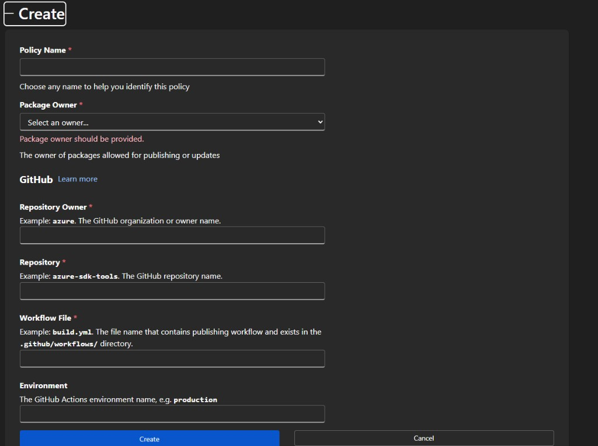
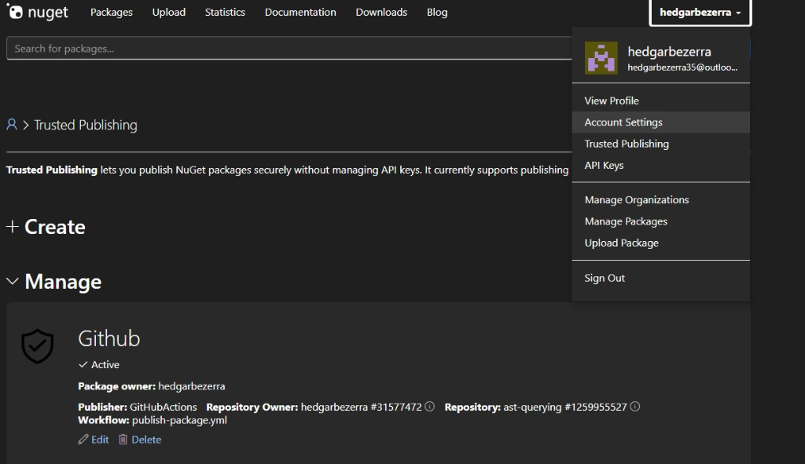

# Pacote `AstQuerying.Queries` — instalação e publicação

**[PT-BR]** Identificador do pacote; **instalar** a partir de **nuget.org** ou **GitHub Packages** (`nuget.config`, autenticação, CI); **gerar e publicar** a partir deste repositório (workflow, GitHub Packages, **nuget.org** com publicação confiável OIDC). Descrição, avisos e **utilização da API** (integração, JSON): [README.md](../README.md).

## Identificador do pacote

O `PackageId` é **`AstQuerying.Queries`**, definido em `src/AstQuerying.Queries/AstQuerying.Queries.csproj`. A versão segue o elemento `<Version>` desse projeto.

## nuget.org (pacote público)

Quando o pacote estiver publicado em **nuget.org**, a origem predefinida do NuGet (`https://api.nuget.org/v3/index.json`) basta; não é obrigatório adicionar outra origem em `nuget.config` se só utilizar pacotes públicos do nuget.org.

**`PackageReference` no `.csproj` (ou `Directory.Packages.props`):**

```xml
<ItemGroup>
  <PackageReference Include="AstQuerying.Queries" Version="1.0.0" />
</ItemGroup>
```

**CLI (na pasta do projeto):**

```bash
dotnet add package AstQuerying.Queries --version 1.0.0
```

Substitua `1.0.0` pela versão publicada. `dotnet restore` obtém o pacote do nuget.org como em qualquer dependência pública.

## GitHub Packages

### Onde colocar o `nuget.config`

O nome do ficheiro pode ser `nuget.config` ou `NuGet.Config` (o NuGet aceita ambos). O cliente **fundir** definições de vários ficheiros; a precedência exata depende da chave, mas o essencial é: **definições mais específicas ao projeto/solução podem sobrepor as globais**.

| Local | Caminho típico (Windows) | Uso |
|--------|---------------------------|-----|
| **Raiz da solução** | Pasta do `.sln`, por exemplo `C:\...\MinhaSolucao\nuget.config` | **Recomendado para equipas:** uma única configuração para todos os projetos da solução. Ao correr `dotnet restore` na pasta da solução ou dos projetos filhos, o NuGet sobe a árvore de diretórios e encontra este ficheiro. |
| **Raiz do repositório** | Onde está o `.git` e, em muitos casos, o `.sln` | Equivalente à raiz da solução quando o `.sln` está no topo do repo. |
| **Pasta de um projeto** | Ao lado de um `.csproj` | Só faz sentido se esse projeto precisar de feeds diferentes dos restantes; caso raro. |
| **Por utilizador** | `%AppData%\NuGet\NuGet.Config` | Credenciais pessoais (PAT), ou feeds privados que não quer versionar no Git. No Linux/macOS: `~/.nuget/NuGet/NuGet.Config`. |
| **Máquina** | `%ProgramFiles(x86)%\NuGet\Config\` (instalações típicas no Windows) | Política de TI; menos comum para GitHub Packages em desenvolvimento. |

Rider e Visual Studio usam a mesma pilha NuGet: as origens e o mapeamento que vê nas definições de “Package Sources” refletem estes ficheiros.

Referência Microsoft: [Comportamento do ficheiro de configuração NuGet](https://learn.microsoft.com/pt-pt/nuget/consume-packages/configuring-nuget-behavior).

**O que versionar no Git**

- **Sim:** `packageSources` (URL com o `OWNER` correto), `packageSourceMapping`, `disabledPackageSources` se precisar.
- **Não:** `packageSourceCredentials` com PAT, nem `ClearTextPassword` no repositório.

Fluxo habitual: no repo fica um `nuget.config` **sem** palavra-passe; cada programador adiciona credenciais no ficheiro **do utilizador** ou via `dotnet nuget add source` com `--store-password-in-clear-text` apenas na máquina local (ou via segredo no CI).

### Origem no `nuget.config`

O feed NuGet do GitHub é sempre da forma abaixo; substitua **`OWNER`** pelo utilizador ou organização que **publicou** o pacote (o mesmo segmento que aparece em `https://github.com/OWNER/...`).

`https://nuget.pkg.github.com/OWNER/index.json`

A chave da origem (ex.: `github`) é **arbitrária**, mas tem de ser **idêntica** em `packageSourceCredentials` e em `packageSourceMapping`.

Exemplo mínimo de origem (credenciais podem estar noutro ficheiro, por exemplo o do utilizador):

```xml
<?xml version="1.0" encoding="utf-8"?>
<configuration>
  <packageSources>
    <clear />
    <add key="nuget.org" value="https://api.nuget.org/v3/index.json" protocolVersion="3" />
    <add key="github" value="https://nuget.pkg.github.com/OWNER/index.json" />
  </packageSources>
</configuration>
```

`clear` em `packageSources` evita herdar origens indesejadas de ficheiros acima na hierarquia; só use se souber o impacto na vossa solução.

### Autenticação

Quem consome precisa de permissão de **leitura de pacotes** no âmbito desse `OWNER` no GitHub.

- **Máquina local:** PAT clássico com âmbito **`read:packages`**. Em **`USERNAME`** use o seu **nome de utilizador GitHub**; em **`TOKEN`** use o PAT (GitHub documenta este par para o registo NuGet).
- **GitHub Actions** no mesmo repositório ou com acesso ao pacote: frequentemente **`GITHUB_TOKEN`** com permissão `packages: read` (e política do repositório/organização). Noutro repositório que consuma o pacote pode ser necessário PAT com `read:packages` guardado em **segredo** ou permissões explícitas entre repos.

Documentação oficial: [Trabalhar com o registo NuGet do GitHub Packages](https://docs.github.com/pt/packages/working-with-a-github-packages-registry/working-with-the-nuget-registry).

Exemplo de credenciais **apenas** no ficheiro do utilizador (`%AppData%\NuGet\NuGet.Config`), referenciando a mesma chave `github` que no `nuget.config` da solução:

```xml
<configuration>
  <packageSourceCredentials>
    <github>
      <add key="Username" value="SEU_USUARIO_GITHUB" />
      <add key="ClearTextPassword" value="SEU_PAT" />
    </github>
  </packageSourceCredentials>
</configuration>
```

Em CI, em vez de editar XML manualmente, costuma usar-se um passo que regista a origem com token, por exemplo:

```bash
dotnet nuget add source "https://nuget.pkg.github.com/OWNER/index.json" \
  --name github \
  --username OWNER \
  --password "$TOKEN" \
  --store-password-in-clear-text
```

Substitua `OWNER` e `$TOKEN` pelo valor adequado (em GitHub Actions, `TOKEN` pode ser `secrets.GITHUB_TOKEN` ou um PAT com `read:packages`).

### GitHub Actions (consumo)

Num workflow no GitHub, pode versionar só `packageSources` e `packageSourceMapping` no repositório e **registar o feed no agente** com o token do job, sem PAT no Git:

```yaml
- name: Adicionar origem GitHub Packages
  run: |
    dotnet nuget add source "https://nuget.pkg.github.com/OWNER/index.json" \
      --name github \
      --username OWNER \
      --password ${{ secrets.GITHUB_TOKEN }} \
      --store-password-in-clear-text
```

Substitua **`OWNER`** (nas duas posições) pelo dono do feed. No job, declare `permissions: packages: read` (e `contents: read` se precisar). Se o pacote for de **outro** repositório e o `GITHUB_TOKEN` não tiver acesso, use um PAT com `read:packages` num segredo (ex.: `NUGET_READ_TOKEN`) em `--password`.

### Mesmo `PackageReference`

O identificador do pacote é o mesmo que em nuget.org:

```xml
<ItemGroup>
  <PackageReference Include="AstQuerying.Queries" Version="1.0.0" />
</ItemGroup>
```

**CLI** (com origem nomeada `github` no `nuget.config`):

```bash
dotnet add package AstQuerying.Queries --version 1.0.0 --source github
```

Ajuste a versão à publicada no GitHub Packages. Se só tiver uma origem privada configurada, `dotnet restore` na pasta do projeto também a utiliza desde que o mapeamento e as credenciais estejam corretos.

### nuget.org e GitHub Packages no mesmo cliente

Com **duas origens** ativas, o NuGet pode tentar pedidos à origem errada e devolver **403** ou falhas opacas. A solução estável é **`packageSourceMapping`**: associa cada padrão de `PackageId` à origem certa.

Exemplo para manter **nuget.org** para quase tudo e **GitHub** só para `AstQuerying.Queries` (ajuste a chave `github` se usar outro nome):

```xml
<?xml version="1.0" encoding="utf-8"?>
<configuration>
  <packageSources>
    <add key="nuget.org" value="https://api.nuget.org/v3/index.json" protocolVersion="3" />
    <add key="github" value="https://nuget.pkg.github.com/OWNER/index.json" />
  </packageSources>
  <packageSourceMapping>
    <packageSource key="nuget.org">
      <package pattern="*" />
    </packageSource>
    <packageSource key="github">
      <package pattern="AstQuerying.Queries" />
    </packageSource>
  </packageSourceMapping>
</configuration>
```

Se precisar de mais pacotes no GitHub, acrescente linhas `<package pattern="..." />` sob a origem `github`. Documentação: [Mapeamento de origens de pacotes](https://learn.microsoft.com/pt-pt/nuget/consume-packages/package-source-mapping).

## Publicação neste repositório

### Workflow e visibilidade

Este repositório usa o workflow [`.github/workflows/publish-package.yml`](../.github/workflows/publish-package.yml): o `pack` associa o pacote ao GitHub (`RepositoryUrl` / `PackageProjectUrl`); a primeira publicação no GitHub Packages fica **privada por defeito**. O envio do `.nupkg` ao registo GitHub Packages usa `secrets.GITHUB_TOKEN` com `permissions.packages: write` no job de publicação, sem PAT no código para esse fluxo.

- Controlo de acesso e visibilidade no GitHub: [Configurar controlo de acesso e visibilidade de pacotes](https://docs.github.com/pt/packages/learn-github-packages/configuring-a-packages-access-control-and-visibility).

### nuget.org — publicação confiável (OIDC)

O mesmo workflow publica `AstQuerying.Queries` no GitHub Packages e, em `push` para o ramo predefinido do repositório (não em pull request), também no **nuget.org** via **publicação confiável** (token OIDC do GitHub Actions → chave de API temporária no nuget.org). Jobs: `build-test`, `pack`, `publish-github`, `publish-nuget`.

Documentação oficial: [Publicação confiável no nuget.org — GitHub Actions](https://learn.microsoft.com/pt-br/nuget/nuget-org/trusted-publishing#github-actions).

A funcionalidade pode estar a ser disponibilizada gradualmente; se não vir **Publicação confiável** na conta nuget.org, consulte a mesma página Learn.

#### Nome exato do ficheiro do workflow (política no nuget.org)

Na política de publicação confiável, o campo **ficheiro de workflow** deve ser **apenas o nome do ficheiro** (sem caminho):

`publish-package.yml`

Corresponde a `.github/workflows/publish-package.yml`.

#### Checklist de configuração

1. **Política de publicação confiável no nuget.org**
   - Proprietário do repositório GitHub: utilizador ou organização (igual a `github.repository_owner`).
   - Nome do repositório: igual ao nome no GitHub (sem `owner/`).
   - **Ficheiro de workflow:** `publish-package.yml` (só o nome).
   - **Ambiente (opcional):** vazio se o job **não** usar `environment:`. Se o workflow definir `environment: release` (ou outro), registe o **mesmo** nome na política.

2. **Segredo no GitHub (`NUGET_ORG_USER`)**
   - O passo `NuGet/login@v1` requer `with: user:` com o **nome de utilizador do perfil nuget.org** (não o e-mail).
   - Crie o segredo no repositório e referencie `${{ secrets.NUGET_ORG_USER }}`. **Não** coloque o nome real no código versionado.

3. **Permissões dos jobs**
   - `publish-nuget`: `id-token: write` (e `contents: read`, `actions: read` como no YAML).
   - `publish-github`: `packages: write` com `GITHUB_TOKEN`.

#### Capturas de ecrã (nuget.org)

Formulário **Create** de política de publicação confiável:



Lista/gestão de políticas:



#### Diferença em relação ao GitHub Packages

| Destino | Autenticação |
|--------|----------------|
| GitHub Packages | `GITHUB_TOKEN` com `packages: write`; `dotnet nuget push` para `https://nuget.pkg.github.com/...` |
| nuget.org | OIDC: `NuGet/login@v1` obtém chave temporária em `${{ steps.login.outputs.NUGET_API_KEY }}`; `dotnet nuget push` para `https://api.nuget.org/v3/index.json` |

#### Ambiente GitHub (`environment`) — opcional

- **Sem `environment` no job:** na política nuget.org, deixe o campo de ambiente vazio.
- **Com `environment: release` (ou outro):** na política nuget.org, indique o mesmo ambiente; pode usar regras de proteção e aprovações no GitHub.

#### Ligações úteis (OIDC e registo NuGet)

- [README do repositório](../README.md)
- [Publicação confiável — GitHub Actions (Learn)](https://learn.microsoft.com/pt-br/nuget/nuget-org/trusted-publishing#github-actions)
- [Trabalhar com o registo NuGet do GitHub Packages](https://docs.github.com/pt/packages/working-with-a-github-packages-registry/working-with-the-nuget-registry)

---

## English

**Description:** Package id; **install** from **nuget.org** or **GitHub Packages** (`nuget.config`, authentication, CI); **build and publish** from this repository (workflow, GitHub Packages, **nuget.org** trusted OIDC publishing). Overview, notices, and **API usage** (integration, JSON): [README.md](../README.md).

## Package identifier

The `PackageId` is **`AstQuerying.Queries`**, set in `src/AstQuerying.Queries/AstQuerying.Queries.csproj`. The version follows `<Version>` in that project.

## nuget.org (public package)

When the package is published on **nuget.org**, the default NuGet feed (`https://api.nuget.org/v3/index.json`) is enough; you do not need an extra source in `nuget.config` if you only consume public packages from nuget.org.

**`PackageReference` in `.csproj` (or `Directory.Packages.props`):**

```xml
<ItemGroup>
  <PackageReference Include="AstQuerying.Queries" Version="1.0.0" />
</ItemGroup>
```

**CLI (from the project directory):**

```bash
dotnet add package AstQuerying.Queries --version 1.0.0
```

Replace `1.0.0` with the published version. `dotnet restore` pulls from nuget.org like any public dependency.

## GitHub Packages

### Where to put `nuget.config`

The file can be named `nuget.config` or `NuGet.Config` (NuGet accepts both). The client **merges** settings from multiple files; precedence depends on the key, but the important idea is: **solution- or repo-level settings can override global defaults**.

| Location | Typical path (Windows) | Purpose |
|----------|------------------------|---------|
| **Solution root** | Next to the `.sln`, e.g. `C:\...\MySolution\nuget.config` | **Recommended for teams:** one shared configuration for all projects. When you run `dotnet restore` from the solution folder or a child project folder, NuGet walks up the directory tree and picks up this file. |
| **Repository root** | Where `.git` lives and, often, the `.sln` | Same as solution root when the `.sln` is at the repo root. |
| **Project folder** | Next to a `.csproj` | Only when that project needs different feeds from the rest; uncommon. |
| **Per user** | `%AppData%\NuGet\NuGet.Config` | Personal PATs or private feeds you do not want in Git. On Linux/macOS: `~/.nuget/NuGet/NuGet.Config`. |
| **Machine-wide** | `%ProgramFiles(x86)%\NuGet\Config\` (typical Windows installs) | IT policy; less common for GitHub Packages during development. |

Rider and Visual Studio use the same NuGet stack: “Package Sources” in settings reflect these files.

Microsoft reference: [How settings are applied](https://learn.microsoft.com/en-us/nuget/consume-packages/configuring-nuget-behavior).

**What to commit to Git**

- **Yes:** `packageSources` (URL with the correct `OWNER`), `packageSourceMapping`, `disabledPackageSources` if needed.
- **No:** `packageSourceCredentials` with a PAT, or `ClearTextPassword` in the repository.

Typical flow: the repo contains a `nuget.config` **without** secrets; each developer adds credentials in the **user-level** file or via `dotnet nuget add source` with `--store-password-in-clear-text` only on their machine (or via a secret in CI).

### Feed URL in `nuget.config`

The GitHub Packages NuGet feed always looks like this; replace **`OWNER`** with the user or organization that **published** the package (the same segment as in `https://github.com/OWNER/...`).

`https://nuget.pkg.github.com/OWNER/index.json`

The source key (e.g. `github`) is **arbitrary** but must match **`packageSourceCredentials`** and **`packageSourceMapping`**.

Minimal source example (credentials may live in another file, such as the user config):

```xml
<?xml version="1.0" encoding="utf-8"?>
<configuration>
  <packageSources>
    <clear />
    <add key="nuget.org" value="https://api.nuget.org/v3/index.json" protocolVersion="3" />
    <add key="github" value="https://nuget.pkg.github.com/OWNER/index.json" />
  </packageSources>
</configuration>
```

`<clear />` under `packageSources` drops inherited sources from higher in the hierarchy; only use it if you understand the impact on your solution.

### Authentication

Consumers need permission to **read packages** for that GitHub `OWNER`.

- **Local dev:** A classic PAT with **`read:packages`**. For **`Username`**, use your **GitHub login**; for the password/token, use the PAT (as documented for this registry).
- **GitHub Actions** in the same repo or with access to the package: often **`GITHUB_TOKEN`** with `packages: read` (subject to repo/org policy). Another repository consuming the package may need a PAT with `read:packages` stored as a **secret** or explicit cross-repo access.

Official docs: [Working with the GitHub Packages NuGet registry](https://docs.github.com/en/packages/working-with-a-github-packages-registry/working-with-the-nuget-registry).

Example credentials **only** in the user file (`%AppData%\NuGet\NuGet.Config`), using the same `github` key as in the solution `nuget.config`:

```xml
<configuration>
  <packageSourceCredentials>
    <github>
      <add key="Username" value="YOUR_GITHUB_USERNAME" />
      <add key="ClearTextPassword" value="YOUR_PAT" />
    </github>
  </packageSourceCredentials>
</configuration>
```

In CI, instead of hand-editing XML, a step often registers the feed with a token, for example:

```bash
dotnet nuget add source "https://nuget.pkg.github.com/OWNER/index.json" \
  --name github \
  --username OWNER \
  --password "$TOKEN" \
  --store-password-in-clear-text
```

Replace `OWNER` and `$TOKEN` as appropriate (in GitHub Actions, `TOKEN` may be `secrets.GITHUB_TOKEN` or a PAT with `read:packages`).

### GitHub Actions (consuming)

In a GitHub workflow, you can commit only `packageSources` and `packageSourceMapping` and **register the feed on the runner** with the job token—no PAT in Git:

```yaml
- name: Add GitHub Packages source
  run: |
    dotnet nuget add source "https://nuget.pkg.github.com/OWNER/index.json" \
      --name github \
      --username OWNER \
      --password ${{ secrets.GITHUB_TOKEN }} \
      --store-password-in-clear-text
```

Replace **`OWNER`** (both places) with the feed owner. On the job, declare `permissions: packages: read` (and `contents: read` if needed). If the package lives in **another** repository and `GITHUB_TOKEN` lacks access, use a PAT with `read:packages` in a secret (e.g. `NUGET_READ_TOKEN`) for `--password`.

### Same `PackageReference`

The package id matches nuget.org:

```xml
<ItemGroup>
  <PackageReference Include="AstQuerying.Queries" Version="1.0.0" />
</ItemGroup>
```

**CLI** (with a feed key named `github` in `nuget.config`):

```bash
dotnet add package AstQuerying.Queries --version 1.0.0 --source github
```

Use the version published to GitHub Packages. If only your private feed is configured with valid credentials, `dotnet restore` from the project folder will use it as long as mapping and credentials are correct.

### nuget.org and GitHub Packages together

With **two active feeds**, NuGet may query the wrong feed and return **403** or opaque failures. The stable fix is **`packageSourceMapping`**: bind each package id pattern to the correct feed.

Example: keep **nuget.org** for almost everything and **GitHub** only for `AstQuerying.Queries` (rename the `github` key if you chose a different label):

```xml
<?xml version="1.0" encoding="utf-8"?>
<configuration>
  <packageSources>
    <add key="nuget.org" value="https://api.nuget.org/v3/index.json" protocolVersion="3" />
    <add key="github" value="https://nuget.pkg.github.com/OWNER/index.json" />
  </packageSources>
  <packageSourceMapping>
    <packageSource key="nuget.org">
      <package pattern="*" />
    </packageSource>
    <packageSource key="github">
      <package pattern="AstQuerying.Queries" />
    </packageSource>
  </packageSourceMapping>
</configuration>
```

Add more `<package pattern="..." />` entries under `github` if you host additional packages there. Documentation: [Package source mapping](https://learn.microsoft.com/en-us/nuget/consume-packages/package-source-mapping).

## Publishing in this repository

### Workflow and visibility

This repository uses [`.github/workflows/publish-package.yml`](../.github/workflows/publish-package.yml): `pack` links the package to GitHub (`RepositoryUrl` / `PackageProjectUrl`); the first publish to GitHub Packages is **private by default**. Publishing the `.nupkg` to the GitHub Packages registry uses `secrets.GITHUB_TOKEN` with `permissions.packages: write` on the publish job—no PAT in the repo for that flow.

- Access control and visibility on GitHub: [Configuring a package's access control and visibility](https://docs.github.com/en/packages/learn-github-packages/configuring-a-packages-access-control-and-visibility).

### nuget.org — trusted publishing (OIDC)

The same workflow publishes `AstQuerying.Queries` to GitHub Packages and, on `push` to the repository default branch (not on pull requests), also to **nuget.org** via **trusted publishing** (GitHub Actions OIDC token → temporary API key on nuget.org). Jobs: `build-test`, `pack`, `publish-github`, `publish-nuget`.

Official documentation: [Trusted publishing on nuget.org — GitHub Actions](https://learn.microsoft.com/en-us/nuget/nuget-org/trusted-publishing#github-actions).

The feature may roll out gradually; if you do not see **Trusted publishing** on nuget.org, see the same Learn page.

#### Exact workflow filename (policy on nuget.org)

In the trusted publishing policy, the **workflow file** field must be **only the filename** (no path):

`publish-package.yml`

This matches `.github/workflows/publish-package.yml`.

#### Configuration checklist

1. **Trusted publishing policy on nuget.org**
   - GitHub repository owner: user or organization (same as `github.repository_owner`).
   - Repository name: same as on GitHub (without `owner/`).
   - **Workflow file:** `publish-package.yml` (filename only).
   - **Environment (optional):** leave empty if the job does **not** use `environment:`. If the workflow sets `environment: release` (or another name), register **the same** name in the policy.

2. **GitHub secret (`NUGET_ORG_USER`)**
   - The `NuGet/login@v1` step requires `with: user:` with your **nuget.org profile user name** (not email).
   - Create the repository secret and reference `${{ secrets.NUGET_ORG_USER }}`. **Do not** commit the real username to version control.

3. **Job permissions**
   - `publish-nuget`: `id-token: write` (plus `contents: read`, `actions: read` as in the YAML).
   - `publish-github`: `packages: write` with `GITHUB_TOKEN`.

#### Screenshots (nuget.org)

**Create** trusted publishing policy form:


Policy list/management:


#### Difference compared with GitHub Packages

| Target | Authentication |
|--------|----------------|
| GitHub Packages | `GITHUB_TOKEN` with `packages: write`; `dotnet nuget push` to `https://nuget.pkg.github.com/...` |
| nuget.org | OIDC: `NuGet/login@v1` obtains a temporary key at `${{ steps.login.outputs.NUGET_API_KEY }}`; `dotnet nuget push` to `https://api.nuget.org/v3/index.json` |

#### GitHub environment (`environment`) — optional

- **No `environment` on the job:** leave the environment field empty in the nuget.org policy.
- **With `environment: release` (or other):** specify the same environment in the nuget.org policy; you can use GitHub protection rules and approvals.

#### Useful links (OIDC and NuGet registry)

- [Repository README](../README.md)
- [Trusted publishing — GitHub Actions (Learn)](https://learn.microsoft.com/en-us/nuget/nuget-org/trusted-publishing#github-actions)
- [Working with the GitHub Packages NuGet registry](https://docs.github.com/en/packages/working-with-a-github-packages-registry/working-with-the-nuget-registry)
